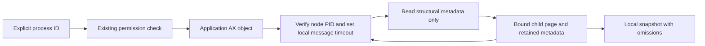

# Mac Accessibility structure recorder

Status: read-only diagnostic with synthetic tests. Real application capture, semantic readers and bound actions remain unqualified.
The approved adapter work still requires authorized 1Password and Little Snitch fixtures.
This module prepares that experiment. It does not select controls or enable either request type.

## Entry point and data boundary

`NativeAXStructureRecorder.capture(processID:limits:)` requires an explicit positive process ID and existing Accessibility permission.
It checks permission without displaying a prompt. Run this synchronous diagnostic on an owned serial worker, not the UI thread.
The recorder returns a local `AXStructureSnapshot`; it does not write files, log the tree, send data or perform target actions.
The separate diagnostic tool can save that snapshot to a new local fixture file.

The separate `macos/ui-adapters` package has no authority, credential, network or privileged-service dependency.
It is not linked into the privileged authority or registered as a background service.

| Recorded | Excluded |
| --- | --- |
| Role and subrole | Field values, titles, descriptions and identifier values |
| Available attribute and action names | Selected text, passwords, clipboard data and screenshots |
| Child links and explicit read failures | Clicking, scope changes, typing and credential insertion |
| Observation ID and requested process ID | Claims about signing identity, process incarnation or app compatibility |

Attribute names such as `AXValue` can appear in the inventory. Their values are never requested.
Role, subrole and name strings remain untrusted application data. Review any fixture before sharing it.
An observation ID distinguishes captures. A node ID identifies only one node within that capture.
A process ID alone does not authenticate an application or prevent process-ID reuse.

## Local capture tool

The package builds `remozio-ax-structure`. It requires an explicit positive PID and a new absolute output path.
Only run a positive-PID capture during the authorized fixture session, from an ordinary user account with existing Accessibility permission.
The tool does not request permission, elevate, open an application, or change its settings.

Select the qualified ordinary-user binary before the attended session. Record its absolute path and SHA-256 with the fixture.
Use the verified PID, binary path and existing private output folder:

```fish
set -l remozio_ax_probe '/absolute/qualified-build/remozio-ax-structure'
set -l remozio_fixture_pid 'REPLACE_WITH_VERIFIED_PID'
set -l remozio_fixture_output '/absolute/owned-private-folder/OP-01-structure.json'
"$remozio_ax_probe" --pid "$remozio_fixture_pid" --output "$remozio_fixture_output"
```

The output folder must belong to the current user and must not permit group or other users to write.
Normal directory aliases work: the writer resolves the parent once, then opens its canonical path with no-follow directory descriptors.
It holds the final directory descriptor during publication. The destination itself is never followed or replaced.
The tool does not create missing output folders.

The writer stages mode-0600 JSON in that directory, syncs it, and publishes it through a no-replacement hard link.
Existing files and destination symlinks remain intact. Failed ordinary attempts remove their own staging file when its identity still matches.
A crash can leave a private staging file. Publication uncertainty preserves the destination and reports failure without a retry.
The encoded artifact has an 8 MiB limit. This JSON contains local diagnostics; it is not encrypted or an approval record.

Successful publication prints only a fixed result marker, node count and traversal stop code.
`STRUCTURE_CAPTURE_SAVED` means the diagnostic was saved, not that all fields were readable or a prompt is supported.
The tool never prints the tree, target text, user arguments or output path in error messages.
`--help` and invalid arguments exit before any permission query or capture.

## Bounded observation



Defaults permit 256 nodes, depth 16, 64 children per node and 128 names per name array.
Each retained string has a 128-byte UTF-8 limit; all retained strings share a 128 KiB budget.
The collector permits 4096 source operations and a two-second elapsed budget, with a 200 ms native message timeout.
The limits have validated upper bounds. Oversized strings and arrays become unavailable; they are not truncated into potential selectors.

Child arrays use the native bounded-page API. Nodes use Core Foundation identity comparison, so cycles and aliases cannot expand indefinitely.
Each visited node must report the requested PID before metadata reads. A foreign or invalid node remains visible as unavailable.
The timeout applies to the exact element object, without changing the client's global timeout or the target UI.

Elapsed and operation budgets are checked before each source operation. One child operation can make two native API calls.
They are not a proven hard wall-clock bound on a wedged OS framework. Actual timeout behavior needs the native fixture session.
Clock failure stops observation. The recorder makes no retries.

Read failures, limited child lists and discovered-but-unread nodes remain explicit.
`finished` means traversal ended within its budgets; it does not mean every field or subtree was available.
The snapshot is not atomic. App changes during traversal can produce an inconsistent observation.
Neither a successful read nor an action name supplies an approval or a dispatch permit.

## Notification ownership

`NativeAXObservationSession` is an explicit diagnostic observer for one supplied PID, with existing permission and main-actor ownership.
It subscribes to four fixed hints: window creation, focused-window change, focused-element change and element destruction.
These names are an experimental inventory, not a validated per-app detection profile.
The callback ignores the supplied target element and has no user-info dictionary, external sink or capture work.
Unknown notification names are ignored. No notification text or target object enters the retained buffer.

Repeated hints coalesce into a set of at most four enum values. `drain()` returns and clears that set.
It is not an ordered event log. A hint cannot establish request creation, timeout, disappearance or a successful action.
The caller must perform a separate bounded recapture on its worker and validate the target's current semantics.
There is no automatic recapture or background task in this component.

Registration failures remain explicit. A partially supported observer keeps its accepted hints and reports the others as unavailable.
If nothing can be registered, construction fails with the concrete permission, process or messaging error where available.
Main-run-loop source attachment must succeed before the session reports running.

`close()` first clears and disables the mailbox, then removes and invalidates the local source, and then removes accepted registrations.
Cleanup continues after individual removal errors; those errors remain diagnostic data.
The observer is released, closing prevents later hints, and active registration claims become empty.
Close is idempotent. Isolated deinitializers perform the same cleanup on the owning actor.
The source joins common modes; actual local-source attachment, invalidation and owner deinitialization pass tests.

No real AX observer has been created in this qualification. The command remains a one-shot capture tool and does not start this observer.
Actual target notifications, native AX registration/removal, application exit and restart, permission changes and callback lifetime
still require the authorized fixture session. App signing identity and process incarnation remain separate requirements before production admission.

## Synthetic test coverage

The package defines 28 synthetic and owned-resource tests. They cover bounded traversal, explicit read failures, fixture publication and observer ownership.
The graph fixtures use invented data. Recorder entry tests reject invalid PIDs before querying permission.
Observer tests cover the local run-loop source and mailbox lifetime. They do not create a real AX subscription.

The Mac local gate requires the package tests and stops when they fail. The Python gate test checks that failure propagation.
Run the complete local gate before publication. Retain the candidate source, compiler, SDK, build and test output, and actual terminal evidence.
Qualify the executable with its help and invalid-argument paths before selecting it for the attended session.
Those argument checks establish no target application compatibility.

## Required fixture session and implementation

Capture real structures only during the authorized feasibility session. Record the target app version, signing identity and process incarnation separately.
Cover locked/unlocked 1Password, SSH and CLI access, password fallback, failed unlock, timeout and multiple simultaneous prompts.
For Little Snitch, cover default scope, supported scope controls, queued alerts, reorderings, process replacement and a second connection attempt.
Do not change application lock settings, Accessibility grants or the Little Snitch scripting setting as a discovery shortcut.

Then add validated per-app field readers and semantic capture contracts from those fixtures.
Request details, actual action effects, app-specific observation, independent signature checks and the one-use dispatch path remain unimplemented here.
Live observer behavior and native callback lifetime remain unqualified.
Direct secure-field targeting is a separate feasibility gate. This recorder supplies no evidence for credential injection.
Unsupported dialogs must retain the approved pending/manual route when the production adapters are composed.
