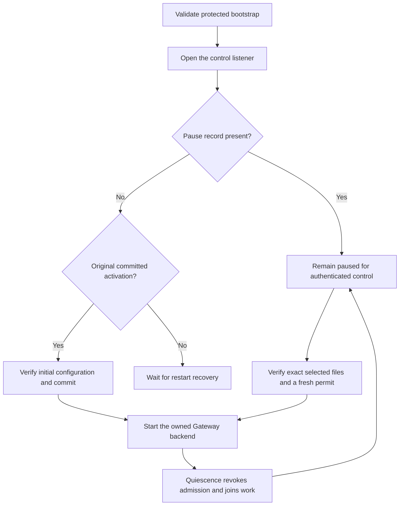

# Keep Gateway control available while its backend changes

A native Gateway host loads immutable protected bootstrap metadata before opening its backend.
It validates the dedicated account, code pins, release identity and service activity scope.
The control listener has its own lifetime. A missing optional backend does not replace that listener.

The pause reader accepts absence only when the exact file is missing.
Malformed, unsafe or changed records refuse optional startup.
Legacy Gateway and Transport wake readers also honor that pause.
The protected publisher compares current retained state and exact selected files before removing a completed pause.
Signed reader support is required before publishing a record that can pause consumers.

Initial startup only accepts the original committed version 1 activation without a pause.
After authenticated quiescence, that process cannot silently return to initial startup.
Selected settings require a fresh permit bound to the current process and exact published bytes.
A completed settings restart still needs the separate recovery coordinator.

Transport bootstrap codec 2 can retain its immutable host metadata alongside direct, pairing, wake and relay settings.
Wake replacement preserves those other fields. Gateway proposals also preserve the earlier Root control flag.
Signed declarations list exact host, nested Transport and Gateway codec readers and emitters.
They also preserve the preceding public and private activity record contracts.
Actual Debug and Release artifact checks compare these declarations with compiled contracts.
An unchanged Gateway proposal test remains a guarded validation input rather than a duplicate staged edit.

Owned readers, publication, lifecycle and initial startup controls verify the mechanisms.
They do not establish installed dedicated account or Developer ID admission.
Restart recovery, fixed host selection and the visible app action follow separately.
Fresh native activation stays disabled until the complete signed participant family is present.
No installed services, production secrets, physical devices or frozen recovery artifacts are used for these checks.

## Guard optional wake work during a settings change

The wake runtime accepts a revocable guard for one selected configuration.
It checks that guard around channel handshakes, hint replies, challenge signing and wake submission.
Native construction checks the dedicated account before reading the configured signer.
The existing public constructors retain their account and peer checks.

Owned driver controls cover revocation during handshakes, hint replies, challenge replies, signing and submission replies.
These controls use disposable software keys and synthetic peers.
They do not establish installed service access or native peer admission.
The native Transport host supplies the process permit for the selected wake runtime.

## Keep direct routes independent from wake delivery

The Transport host validates its protected bootstrap and signed release before opening settings control.
The foreground owner starts direct approvals, pairing and the configured relay.
A separate owner starts optional wake delivery with the exact initial or accepted settings.
A slow wake handshake cannot block direct polling.

```mermaid
flowchart TD
    B[Validate protected bootstrap] --> C[Start settings control]
    C --> F[Start direct approvals and pairing]
    C --> W[Start optional wake work]
    F --> R[Update the configured relay]
    W --> P[Check the current permit around channel work]
    R --> Q[Retire both owners on shutdown]
    P --> Q
    Q --> J[Join owned work and cleanup]
    J --> L[Release the service activity scope]
```

A failed foreground start retains its owner until cleanup succeeds.
Polling retries that cleanup before creating a replacement.
Concurrent shutdown joins the same owned work and prevents a late replacement.
The existing entry points retain their supported configuration formats and shutdown behavior.
The new settings host entry is explicit. Native activation selection remains disabled pending Root recovery and update coordination.
