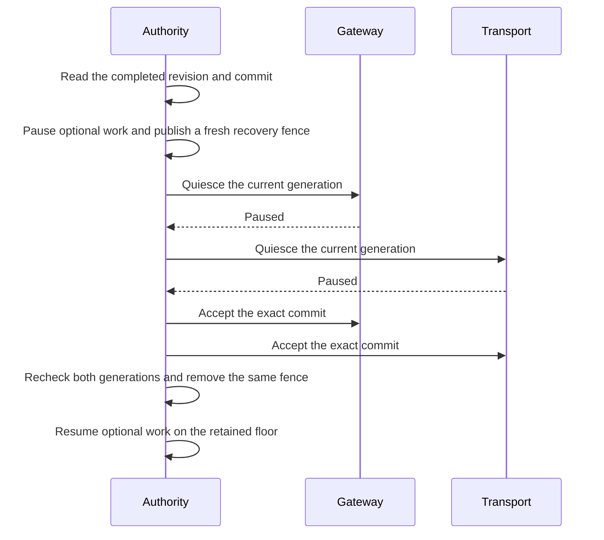

# Recover retained settings after a process restart

A restart does not restore a serialized acceptance or advance the approved settings revision.
The Authority captures retained state before transferring its startup store ownership.
It keeps optional work paused until both consumers accept the exact completed commit in their current generations.
Direct approvals keep their separate owner during optional recovery failures.

Version 1 settings changes retain their exact wire bytes and successor requirement.
Version 2 recovery keeps the commit unchanged and adds a fresh attempt identifier.
The signed release lists the exact readers and writers before a recovery fence can be published.
The Authority uses a separate recovery endpoint. Setup retains its distinct caller policy.
A lost reply, changed scope or partial acceptance does not establish readiness.
Old cleanup cannot pause a newer settings successor.

Owned controls cover the codecs, protected publication, restart generations, partial acceptance and cancellation.
They do not establish installed Root admission, production credentials or provider delivery.
Fresh native host selection and the visible settings action remain separate integration work.
No installed service or physical device test is part of these controls.
