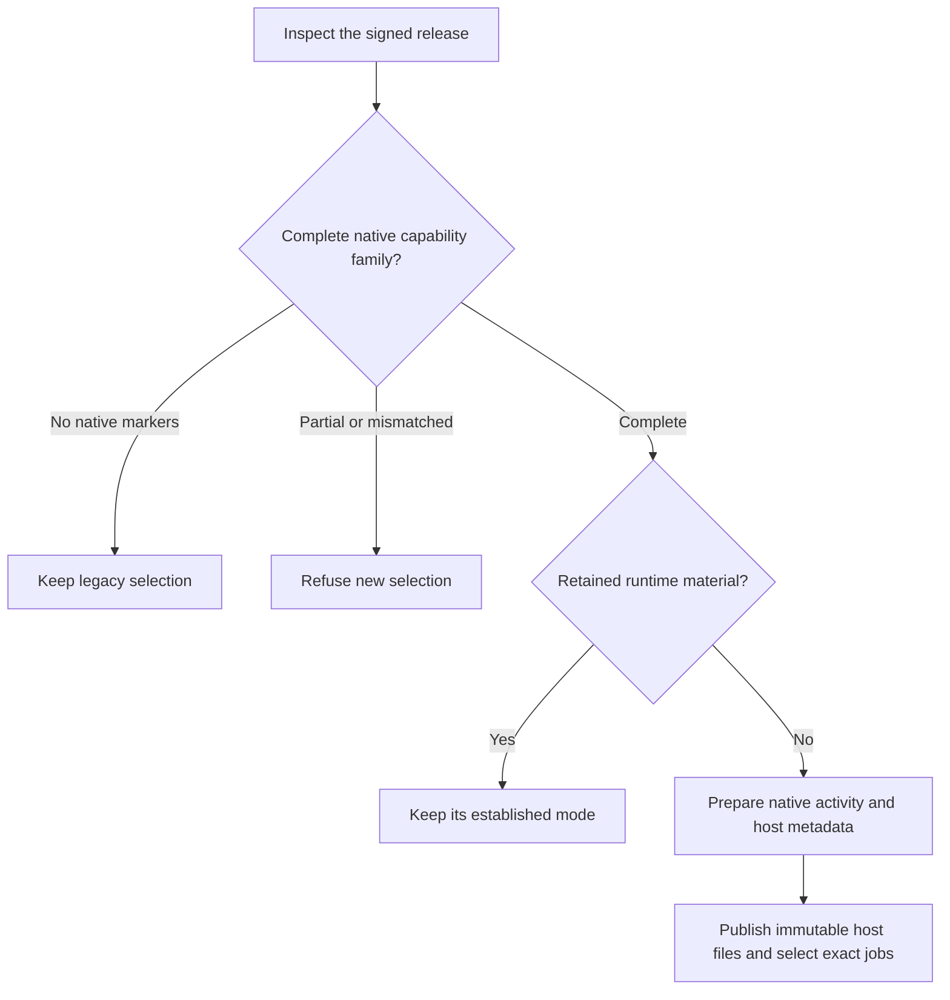

# Select the complete native settings hosts

New runtime material can select the native host family only after the signed release passes compatibility checks.
Retained material keeps its existing mode. A changed bundle does not silently replace that material or its identity.

Activation codec 2 retains both host selections. Codec 1 keeps its exact record and launch arguments.
The Gateway and Transport jobs declare their separate setup and recovery endpoints alongside existing services.
Protected publication and validation include the immutable Gateway host file.
An inactive release compatibility check reopens retained records and requires their actual readers before returning evidence.
The check does not install an update or grant activation authority.

Synthetic signed evidence and owned store controls do not prove installed native admission or service restart behavior.
The visible Gateway setup action, production credential continuity and physical Mac–Pixel tests remain separate work.
