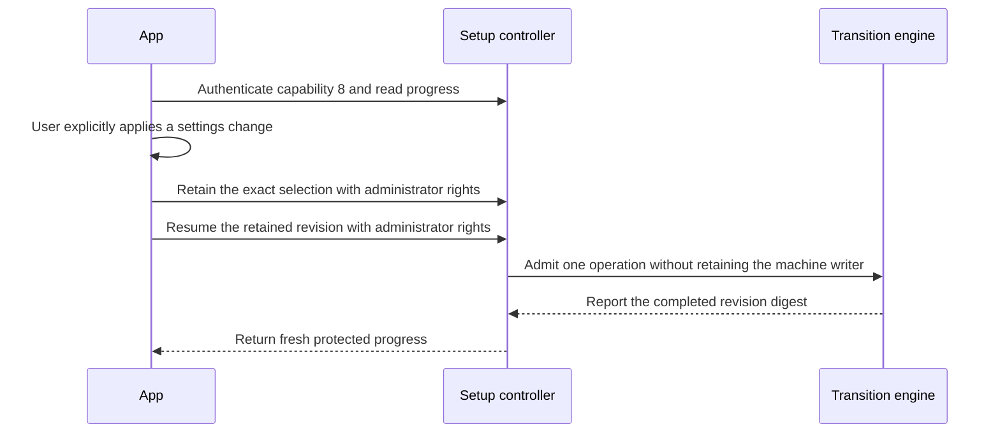

# Admit an explicit app settings change

Setup IPC capability 8 adds settings progress, retention and resume calls. Capabilities 1 through 7 keep their existing calls.
The app authenticates the pinned Root peer before sending administrator authorization.
Reading progress never requests administrator rights or starts a transition.

The native endpoint verifies the invocation and authorization before it starts asynchronous work.
Its shared owner rejects stale progress and serializes admission. A pending revision cannot be replaced by another selection.
A lost reply requires progress readback. The client does not repeat a mutation automatically.
Disconnect and cancellation release the reply and activity scopes after asynchronous work settles.

The native service enables these calls only for the complete signed host family.
Owned stores and anonymous XPC tests check ordering and selectors. They do not prove installed peer admission or administrator consent.
The [Mac settings sheet](macos-gateway-settings-app.md) now connects this interface to explicit user actions.
Portable import/export and provider credential continuity remain separate integration work.

Progress reports whether the retained hosts support live settings changes. An older enrollment remains readable and keeps its identity.
The app must explain an unsupported mode before requesting administrator rights. It must keep the existing service restoration action available.
