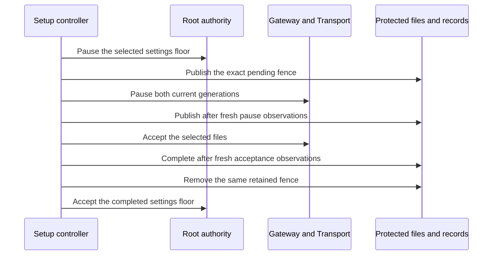

# Apply a retained Gateway settings change

The transition engine uses one exact pending revision. Saved phases never replace fresh process observations.
The authenticated setup owner must admit the operation. This engine grants no administrator rights.

The engine checks the captured Root epoch and both consumer generations before completion.
Its temporary barrier cannot be reconstructed from a database phase. It becomes invalid when the operation ends.
A failure leaves retained progress available for an explicit retry. It does not roll back files or silently resume delivery.
Completed revisions use the separate restart recovery path.

Native calls reopen protected state for short synchronous checks. They retain no machine writer during an asynchronous exchange.
The native entry requires Root, the current signed bundle, an enrolled account and the retained activity scope.

Owned files, SQLite stores and injected peers test ordering, interruption and generation changes.
These tests do not prove installed code admission, administrator consent, dedicated account isolation or physical phone delivery.
[Setup capability 8](macos-settings-app-interface.md) and the [Mac settings action](macos-gateway-settings-app.md) connect this engine to explicit user actions.
Provider credential continuity and installed service validation remain unproven.
