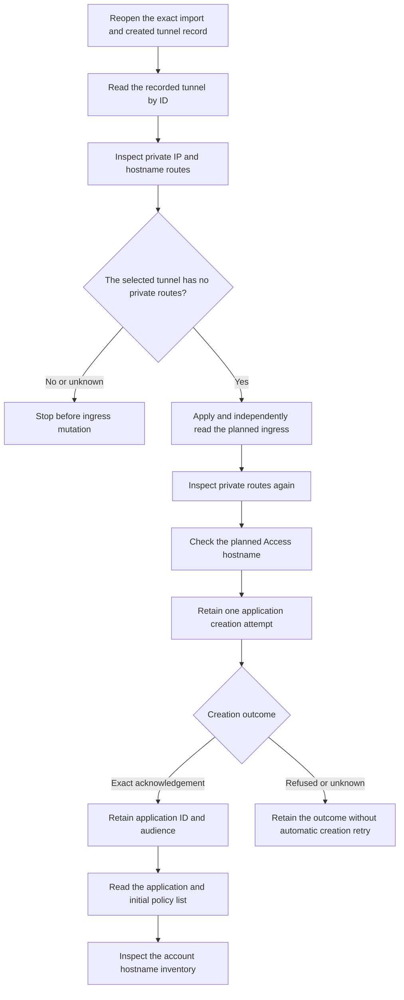

# Retained Access application setup

This slice joins the retained tunnel to scoped ingress publication and initial Access application setup.
It creates no phone service token or allowing policy.

The setup owner reopens protected local state before each provider request and after each operation.
It compares the current import, account, installation, tunnel ID and retained file identity.
Network waits do not hold the machine lease. Admission and release activity remain owned until settlement.

Initial application readback checks the selected hostname, audience and noninteractive settings.
It also checks the application's initial empty policy response.
The account inventory includes public destination aliases, wildcard overlap and unresolved routing fields.
These observations do not prove provider routing precedence or authorize DNS publication.

The private-route checks use tunnel-filtered responses.
A provider's global result total does not identify routes belonging to this tunnel.
A route, malformed response or unavailable read cannot establish the required empty observation.

A late creation acknowledgement is retained before cancellation is reported when the current scope permits recording it.
An unresolved dispatch remains unresolved if state changes prevent that record.
Neither reconnection nor a repeated setup call replays an uncertain creation request.

## Validation boundary

The focused run passed 233 synthetic controls at source `f3fd1a1`, with no failures or skips.
It covered the preceding tunnel controls and the new Access, hostname and private-route paths.
This focused result does not substitute for the complete publication gate.

The complete required publication gate remains pending on the final published dependency.
The fixtures use temporary storage and synthetic provider replies.
They test current import binding, empty and overlapping inventories, typed failures, cancellation and retained creation outcomes.

Live provider defaults, hostname precedence, Access authentication and credential custody remain integration gates.
No native credential access, real provider mutation, service installation or device operation belongs to fixture validation.
The app import action, DNS publication, phone credential lifecycle and final import completion remain separate work.
