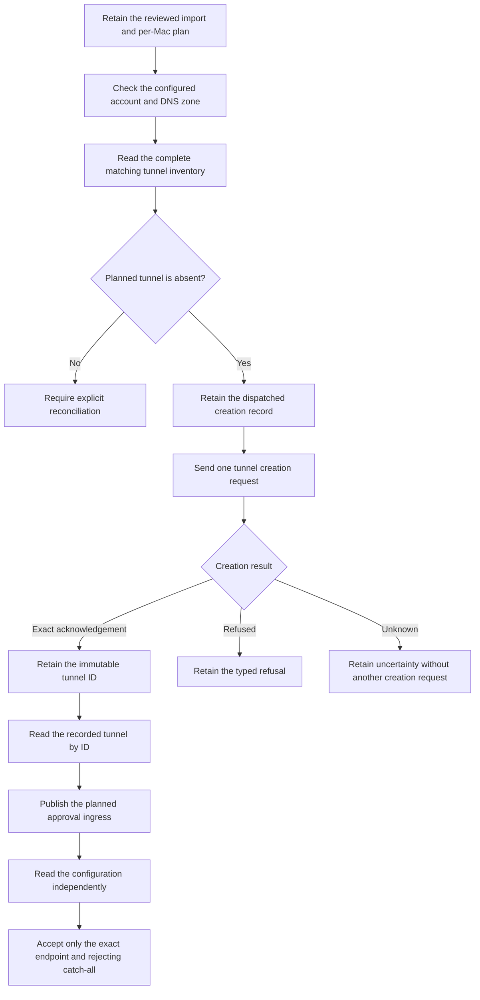

# Per-Mac Cloudflare tunnel setup

This slice connects the retained import to account checks, tunnel creation and exact ingress readback.
Each Mac uses its own retained plan. No Mac becomes the deployment controller.

The provider client uses fixed HTTPS endpoints, a bounded response and typed errors.
It follows no redirect and makes no automatic creation retry.
A matching name cannot replace the tunnel ID from the retained acknowledgement.
A configuration write response does not prove the applied configuration.
An independent read checks the selected account, tunnel and complete ingress rules.

The filtered inventory ends only after an empty result page.
The account-wide `total_count` cannot describe the filtered matches.
A short nonempty page still requires another read.
The client permits ten nonempty pages and one final empty probe, within the existing response and aggregate byte limits.
Missing pages, duplicate IDs and crossed account rows cannot produce partial evidence.
This follows the official [tunnel list pagination](https://github.com/cloudflare/cloudflare-typescript/blob/main/src/resources/zero-trust/tunnels/cloudflared/cloudflared.ts)
and [empty-page completion](https://github.com/cloudflare/cloudflare-typescript/blob/main/src/core/pagination.ts).

The setup owner releases the machine lease during network waits.
It keeps asynchronous admission and release activity until the operation settles.
Before and after each wait, it rechecks the import, account, installation and retained plan identity.
A late acknowledgement is retained before cancellation is reported when the current scope still permits that write.
Unresolved dispatch remains unresolved when local state no longer permits recording the result.

This is component progress. It does not declare the complete import ready.
Access application creation, DNS publication, private-route checks and native relay startup remain separate work.
The source does not add an app import action in this slice.

## Validation boundary

The focused run passed 141 synthetic controls at source `0e370c6`, with no failures or skips.
It checked the provider clients, retained creation state, current import scope and late or uncertain outcomes.
This focused result does not substitute for the complete publication gate.

The source is prepared for the complete required gate on its final published dependency.
That gate must finish before publication. Keep the reports and source hashes in the local checkpoint.
Existing tests use temporary storage and synthetic provider replies.
They do not establish provider permissions, a real tunnel connection or background phone delivery.
No service installation, native credential access or physical device operation belongs to this gate.

The source contract was compared with the official [zone API](https://developers.cloudflare.com/api/resources/zones/methods/get/)
and [tunnel creation API](https://developers.cloudflare.com/api/resources/zero_trust/subresources/tunnels/subresources/cloudflared/methods/create/).
Native provider behavior still needs an explicitly authorized integration session.
