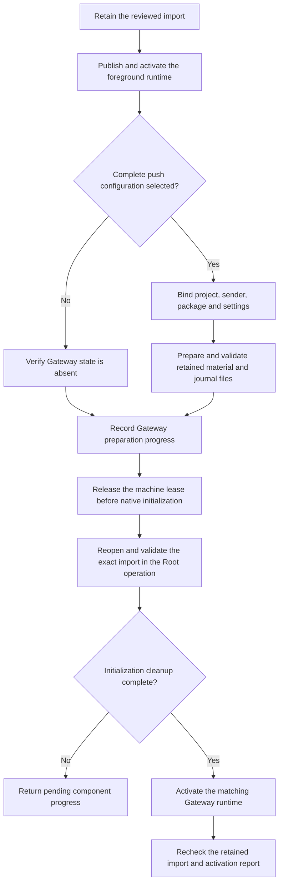

# Imported push settings and Gateway runtime

This slice joins a retained setup import to Gateway material preparation, journal initialization and runtime activation.
It keeps the existing foreground runtime and service ownership checks.

The setup owner compares the complete provider input and selected settings before recording preparation.
Recovery validates existing material and journal files. It does not replace accepted outputs or silently choose different settings.
An import without push configuration requires absent Gateway material, journal, activation and settings state.

Initialization and activation reopen their own machine lease. They compare the same import revision, scope and selected activation settings.
The asynchronous owner holds its admission and release activity until the operation settles.
A changed import, account, installation or runtime prevents a successful result.
Legacy mutation paths reject a retained import that needs this scoped workflow.

The returned result reports component progress and cleanup status. It does not mark the entire import complete.
The app import action, authenticated export/import, relay provider dispatch and final import completion remain separate work.
No new setup IPC capability or app action is exposed here.

## Validation

The source is prepared for the complete required local gate on the current published dependency.
The gate must finish before publication. Its reports and source hashes stay in the local checkpoint.
The earlier private focused results do not substitute for that gate.

The fixtures use ordinary ownership, temporary files and synthetic provider inputs.
No service installation, native credential access or provider request is part of fixture validation.
Real job registration, service accounts, credential custody and the physical Mac–Pixel flow remain supervised gates.
