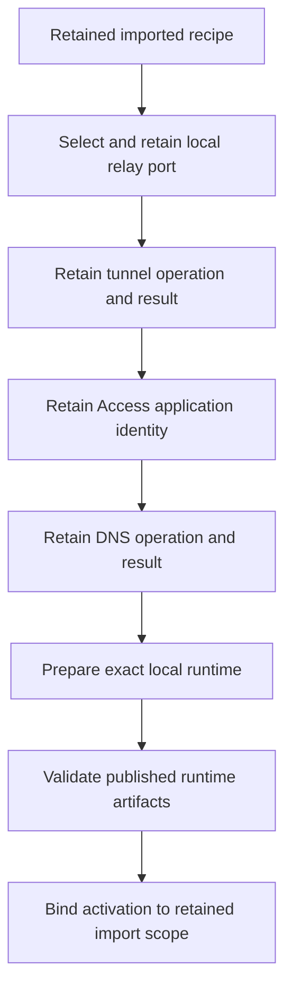

# Imported relay setup and native runtime activation

## Purpose

Keep each Mac's relay resources local when it imports shared setup choices.
Retain the selected local port and provider resource identities across interrupted setup.
Join that retained selection to native runtime preparation and activation.

## Retained records

The import owner stores separate protected records for the relay plan, tunnel creation, Access application and DNS publication.
Each record binds the exact import scope and local operation.
Returned provider identities cannot change during recovery.
File snapshots retain identities and digests so replacement or mutation cannot silently change an accepted selection.
Unknown files remain incompatible state. They are not removed or treated as an empty store.

The setup owner holds the machine and import leases while it validates these records.
A missing accepted output cannot be repaired after runtime publication.
A port collision never silently selects another port after retention.
The native preparation entry point reopens the current import and validates its relay selection around publication callbacks.
Activation uses the same retained recipe and configuration scope.
The current root artifact reader and original service caller restrictions remain intact.

## Validation boundary

Earlier focused controls passed on the private relay-retention source.
The current source also includes the published runtime reader fix and the current main shared consumption ledger.
It requires a fresh complete repository gate before publication.
Retain that gate's actual reports and source hashes separately from the earlier focused results.

These internal records do not expose a production import action or a new setup capability.
Native provider dispatch, credential custody, authenticated export/import and final import completion remain separate work.
No provider request, credential access, service installation or physical device test is part of this slice.
Real launchd operation and the Mac-Pixel approval session remain supervised gates.
