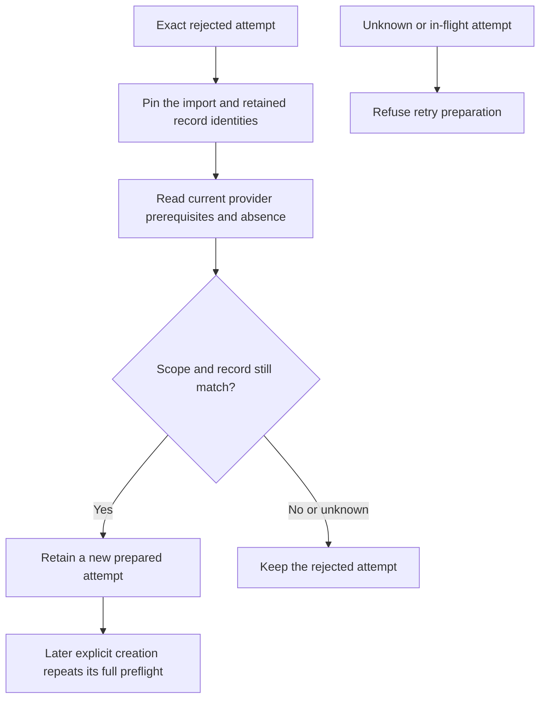

# Preparation after a provider refusal

The Root owner can prepare a new tunnel, Access application or DNS attempt after a confirmed refusal.
The caller must obtain fresh administrator authorization and bind the exact rejected record digest.
These operations prepare local metadata. They send provider reads and no creation request.

| Resource | Retained prerequisites | Fresh provider observations |
| --- | --- | --- |
| Tunnel | Import scope, plan and rejected tunnel record | Account, zone and complete matching tunnel inventory |
| Access application | Import scope, plan, created tunnel and rejected application record | Exact tunnel readback and matching application absence |
| DNS record | Import scope, plan, created tunnel, created application and rejected DNS record | Exact tunnel readback, ingress, private routes, initial Access settings, hostname coverage and DNS absence |

Each operation pins record content and file identity across its provider inspection.
Access and DNS also recheck before and after each HTTP receipt, including failed read sequences.
A provider-client error cannot hide a changed local record or import scope.
Tunnel inspection checks its complete read operation before preparing local state.

Preparation preserves the record ID and request digest, increments the attempt number and creates a new attempt ID.
A stale digest cannot prepare another attempt. A cancellation before publication leaves the refusal intact.
An admitted local publication can still settle after cancellation; client cancellation alone does not establish its outcome.
No operation grants a reusable absence permit. A later creation runs the normal complete preflight again.
Existing unknown, dispatched, prepared and created records cannot be rearmed through these operations.
An observed resource cannot be adopted by matching its name.

The DNS path refuses unresolved hostname precedence and provider conflicts before local rearming.
Changes to retained parent resources also stop the operation.
Network reads hold asynchronous admission and release activity while leaving the database leases available.
Shutdown closes new admission and preserves ownership until the operation settles.

## Evidence and remaining integration

The focused integrated run passed 54 tests with no failures or skips on macOS 27.0.1.
It covered new refusal controls and existing tunnel, Access and DNS creation controls.
The cases include every read-failure position, every scope-change receipt, file replacement, conflicts, cancellation and shutdown.
All provider replies are synthetic. The tests use disposable ordinary-user storage.
They do not establish native administrator authorization, installed Root admission, real provider behavior or macOS 26 runtime support.

The native request format and app recovery action remain separate work.
They must carry the rejected-record digest and preserve current progress binding and fresh administrator authorization.
Automatic import does not invoke these operations. Unknown-outcome adoption remains unsupported.
A complete local publication gate must pass before these private changes are pushed.

## Read-only recovery snapshot

The setup owner can read current import progress and public provider history in one bounded response.
It returns no metadata until the account and its service accounts are prepared.
Before an import exists, the read leaves the import directory absent.
A missing relay plan stays missing. The read never prepares or repairs a resource.

| Field | Meaning |
| --- | --- |
| Import progress | Existing destination and retained import binding |
| Relay scope | Retained provider account, zone, hostname and tunnel name |
| Resource state | Prepared, dispatched, created, rejected or unknown history |
| Record digest | SHA-256 of the complete retained record, for exact retry binding |
| Attempt number | The retained creation-attempt counter |
| Provider ID | Present only after a recorded creation acknowledgement |
| Refusal | A closed typed value, present only for a rejected attempt |

The projection captures content digests and inode identities, then rechecks them before returning its derived metadata.
It validates parent records and rejects corrupt or orphan files without rewriting them.
A changed or newly created file invalidates an earlier capture, including replacement with identical content.
Only rejected entries are returned by the explicit-retry selector. That selector grants no authorization.

The canonical message has a version, purpose marker, closed field sets and a 4,096-byte limit.
Its decoder rejects unsupported versions, crossed identities, duplicate or unordered resources and missing created parents.
Credential fields and provider response bodies are absent. Default descriptions and reflection redact the report and its entries.
This is an ephemeral read model; it changes no persisted format.

The projection validation covered 65 distinct focused cases, including the read before import storage exists.
It proves codec and owned-storage behavior. Native IPC delivery and app use remain separate integration work.
The next native interface must negotiate support before sending these messages or accepting new retry writes.
Existing native versions remain unchanged in this component.

## Native recovery read interface

Setup IPC 10 adds `portableImportRecoveryHello` and `portableImportRecovery`.
The app must choose this handshake explicitly and authenticate the Root peer before using its reply.
Every call and reply rechecks the peer. The endpoint reads only the invoking account's retained metadata.
Versions 1 through 9 cannot read this report. Version 9 remains available with its original selectors and request bytes.
Version 10 also accepts the existing version-1 import operations. A missing or different handshake causes a closed connection without fallback.

An empty reply means account preparation has not reached the required stage. It does not mean the provider is ready.
The client bounds report size, checks canonical encoding and requires its own account UID.
It never exports administrator rights for this read. Cancellation and timeout close the channel without another attempt.
Only the app and setup component declare IPC 10. The report is ephemeral and adds no persistent format declaration.

The focused run passed 29 Swift cases and 23 manifest cases. The owned anonymous XPC test reads a rejected DNS record twice across fresh connections.
It verifies the same retained files, rejected state, kernel invocation checks and zero rights requests.
This is same-process, ordinary-user evidence. It does not prove an installed Root service, Developer ID admission or actual administrator consent.
The host runs macOS 27.0.1 and compiles for macOS 26. This does not qualify the macOS 26 runtime.
No native retry write or app recovery button is connected by this interface change.
