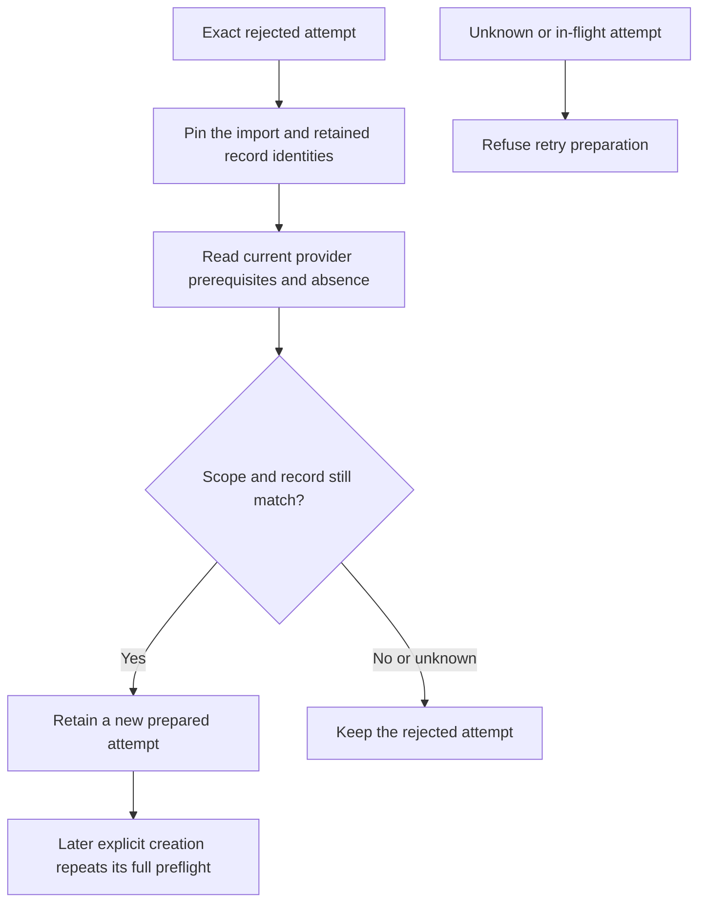

# Preparation after a provider refusal

The Root owner can prepare a new tunnel, Access application or DNS attempt after a confirmed refusal.
The caller must obtain fresh administrator authorization and bind the exact rejected record digest.
These operations prepare local metadata. They send provider reads and no creation request.

| Resource | Retained prerequisites | Fresh provider observations |
| --- | --- | --- |
| Tunnel | Import scope, plan and rejected tunnel record | Account, zone and complete matching tunnel inventory |
| Access application | Import scope, plan, created tunnel and rejected application record | Exact tunnel readback and matching application absence |
| DNS record | Import scope, plan, created tunnel, created application and rejected DNS record | Exact tunnel readback, ingress, private routes, initial Access settings, hostname coverage and DNS absence |

Each operation pins record content and file identity across its provider inspection.
Access and DNS also recheck before and after each HTTP receipt, including failed read sequences.
A provider-client error cannot hide a changed local record or import scope.
Tunnel inspection checks its complete read operation before preparing local state.

Preparation preserves the record ID and request digest, increments the attempt number and creates a new attempt ID.
A stale digest cannot prepare another attempt. A cancellation before publication leaves the refusal intact.
An admitted local publication can still settle after cancellation; client cancellation alone does not establish its outcome.
No operation grants a reusable absence permit. A later creation runs the normal complete preflight again.
Existing unknown, dispatched, prepared and created records cannot be rearmed through these operations.
An observed resource cannot be adopted by matching its name.

The DNS path refuses unresolved hostname precedence and provider conflicts before local rearming.
Changes to retained parent resources also stop the operation.
Network reads hold asynchronous admission and release activity while leaving the database leases available.
Shutdown closes new admission and preserves ownership until the operation settles.

## Evidence and remaining integration

The focused integrated run passed 54 tests with no failures or skips on macOS 27.0.1.
It covered new refusal controls and existing tunnel, Access and DNS creation controls.
The cases include every read-failure position, every scope-change receipt, file replacement, conflicts, cancellation and shutdown.
All provider replies are synthetic. The tests use disposable ordinary-user storage.
They do not establish native administrator authorization, installed Root admission, real provider behavior or macOS 26 runtime support.

The native request format and app recovery action remain separate work.
They must carry the rejected-record digest and preserve current progress binding and fresh administrator authorization.
Automatic import does not invoke these operations. Unknown-outcome adoption remains unsupported.
A complete local publication gate must pass before these private changes are pushed.
