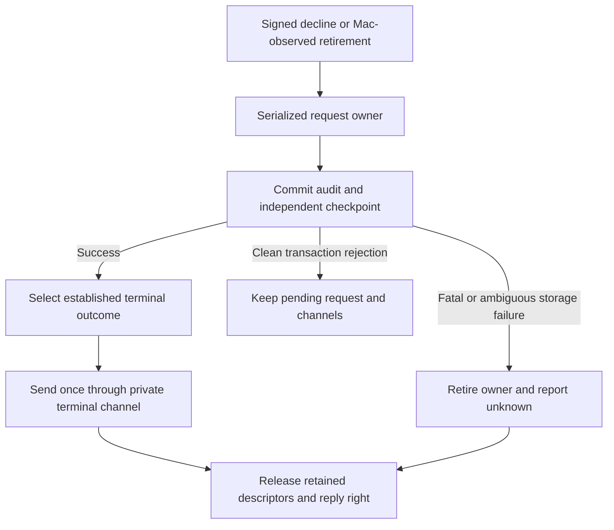
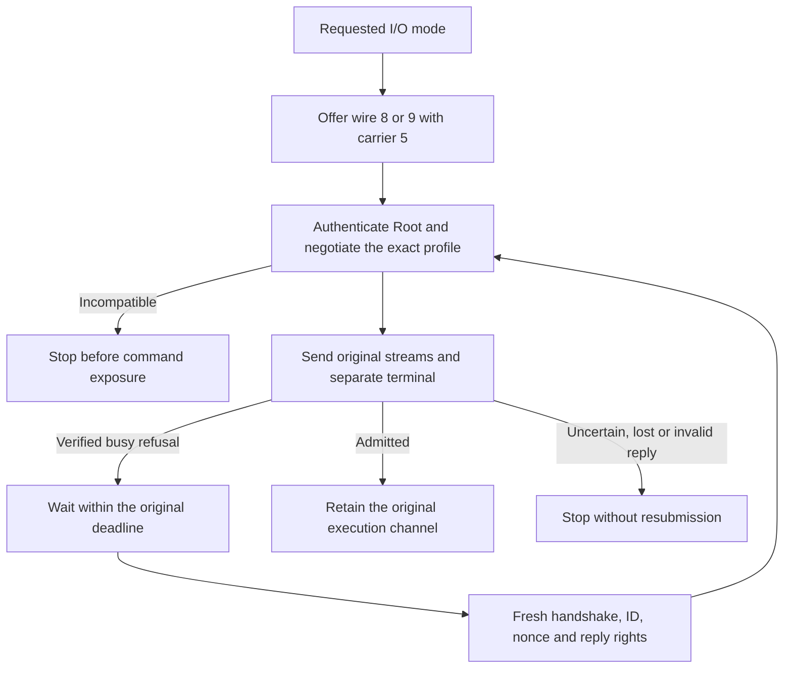

# Retained command I/O channels

The explicit `executionChannels` profile selects local wire 3, submission schema 1, and input carrier 4.
It retains stdin, stdout, stderr, an admission reply, and a terminal reply for the same authenticated submission.
These resources grant no execution permission.

```mermaid
sequenceDiagram
    participant F as Frontend
    participant K as Mac kernel
    participant R as Serialized Root owner
    F->>R: Metadata handshake; verify actual Root and scope
    F->>K: Command, three fileports, two private reply rights
    K->>R: Audit token and complete descriptor layout
    R->>R: Authenticate before import; match original handshake
    R->>R: Own attempt, capture and journal admission
    R-->>F: Exact admission result
    alt Verified busy refusal
        F->>F: Close attempt channels; wait within original deadline
        F->>R: Fresh handshake, ID, nonce and channels
    else Admitted
        F->>F: Retain original Root and terminal endpoint
        Note over F,R: Approval and guarded child supervision remain separate gates
        R-->>F: Terminal observation through retained private channel
        F->>F: Verify original Root, command digest and admitted request
    else Uncertain or lost reply
        F->>F: Close channels; do not resubmit
    end
```

## Carrier and ownership

| Message | ID | Carrier | Contents |
| --- | --- | --- | --- |
| I/O submission | `0x524d0407` | 4 | Stdin, stdout, stderr, admission reply, terminal reply, then the canonical submission |
| Terminal reply | `0x524d0408` | 1 | Canonical result; no carried descriptors |

The submission carries exactly five copied send rights, in the order shown.
The receiver bounds the packet and authenticates its queued sender before importing any descriptor.
Receipt must match the preview's complete audit token and sequence.
All padding must be zero. Unknown layouts, versions and message IDs fail.

The sender borrows the three original descriptors. It reads and writes no stream bytes and changes no shared flags.
Imports create owned descriptors. Output imports require writable descriptors and set `FD_CLOEXEC` only on their copies.
The attempt transfers these resources through the existing capture and journal owner.
Capture failure, refusal, request retirement and closure release the imported descriptors and private reply rights.
Aliases cannot release resources after the first transfer.

Capture and dispatch rechecks include output writability and the terminal right's liveness.
A closed terminal endpoint therefore prevents a later successful recheck.
This check does not supervise an already running child or prove requester-disconnect policy by itself.

## Caller lifetime

`MachCommandIOClient.submit` consumes an exclusively owned authenticated handshake.
An admitted reply returns `RetainedCommandExecutionSession`; every other verified outcome returns `CommandIOAdmission.result`.
That result can report uncertainty. It must not be interpreted as proof of refusal.

The retained session owns the original Root identity and its private terminal endpoint.
`pollTerminalResult` uses a finite control budget and allows cancellation.
An empty queue returns nil and keeps the session alive.
This timeout does not expire the approval or limit the command's runtime.

A received malformed, late or unauthenticated reply closes the session and throws.
A consumed reply cannot become an empty-poll result.
The caller can read a verified terminal observation again, but this grants no replay authority.

`CommandCallerReadiness.submitIO` negotiates this profile and preserves the complete invocation and all three original descriptors.
Only the four exact authenticated busy classes permit a fresh submission.
Each retry uses new IDs, nonces, handshake bindings and private reply endpoints.
One continuous deadline covers connection, admission, validation and backoff.
Permanent refusals, uncertainty, reply loss, cancellation and malformed results never resubmit the command.

## Terminal envelope

The terminal result has exactly seven canonical CBOR keys.
Its limit is 4 KiB, depth 6, and 128 items.

| Key | Value |
| --- | --- |
| 0 | Result format 1 |
| 1 | Complete negotiated profile and Mac/account scope |
| 2 | Original submission ID, nonce and caller binding |
| 3 | SHA-256 of the original canonical submission |
| 4 | Exact admitted request ID, opaque token and challenge |
| 5 | Terminal outcome tag |
| 6 | Exit status, signal, or null |

Tags 1 and 2 carry an exit status from 0 through 255 or a valid nonzero Darwin signal.
Tags 3–8 mean denied, expired, cancelled before start, requester exited before start, failed before start, and unknown.
These six tags require null bodies.
Unknown fields, tags, versions, noncanonical encoding and changed bindings fail.
A refusal or uncertainty cannot establish a terminal session.

Product callers cannot construct `VerifiedCommandTerminalResult` or reuse a consumed handshake.
External Swift compiler probes check both restrictions.
The encoder remains internal. Encoding a value does not prove that a child produced that outcome.

## Committed owner results

The serialized request owner sends a terminal result after the audit transaction and its independent checkpoint succeed.
It uses the retained original submission digest and the admitted request ID, opaque token and challenge. The Authority uses the same token in both directions and in the terminal result.
A successful send closes the private reply right. Retirement then closes the imported descriptors.



| Established owner state | Terminal result |
| --- | --- |
| Committed signed decline | Denied |
| Committed expiry or target timeout | Expired |
| Committed cancellation before dispatch | Cancelled before start |
| Pending authority restart committed as cancellation | Cancelled before start |
| Disappeared target or unavailable outcome | Unknown |
| Owner closure or fatal storage failure | Unknown |

A clean transaction rejection keeps the pending request alive and sends no terminal result.
Prepare or finalize failures retire the owner and report only unknown.
They cannot claim that cancellation committed or that execution had no effect.
Generic success or failure phases do not establish a child's exit status or signal. They therefore report unknown here.

Terminal sends do not wait for queue capacity while holding the authority lock.
A full or dead private queue can lose the result, but cannot undo the committed transition or authorize another invocation.
The caller must treat result loss as uncertainty. These channels do not provide durable result retrieval after a process restart.

## Mapped caller readiness

`CommandCallerReadiness.submitMappedIO` passes a separate caller terminal through the same admission loop.
The caller keeps all borrowed descriptors open. Readiness reads no stream bytes and changes no flags or terminal settings.
It does not activate the frontend terminal lease.

| Requested mode | Explicit offer | Submission carrier |
| --- | --- | --- |
| PTY | Wire 8, submission schema 1 | Carrier 5: three streams, optional terminal, two reply rights |
| Pipes | Wire 9, submission schema 1 | Carrier 5: three streams, optional terminal, two reply rights |

The mode selects exactly one profile, even when Root supports both.
A legacy-only peer receives harmless handshake metadata and an incompatible result.
Readiness does not expose the invocation to that peer or change the requested mode.
The existing `submitIO` API keeps its default and legacy carrier.



All four verified busy classes keep their existing backoff and one continuous readiness deadline.
Cancellation and a reason change cannot reset that deadline.
The deadline bounds readiness; it imposes no command runtime limit.
Admission retains the original authenticated channel, including before-start terminal results.
This API does not start a terminal pump, apply an elevation policy, or execute a command.

Native tests negotiate both modes against a peer that supports both mapped profiles.
Each mode runs with a separate private terminal and with no supplied terminal.
Actual fileports preserve distinct output files, access and flags, terminal attributes, and unread binary input across all four busy classes.
Lost, malformed, wrong-digest, permanent and uncertain replies produce no second invocation.
The tests also check cancellation, shared deadlines, legacy-peer rejection and the public Root-policy guard.
These fixtures use the test user's identity and grant no privilege.
All 21 readiness tests pass locally on macOS 27.0.1 and in [macOS 26 CI](https://github.com/rock3r/remozio/actions/runs/38020555477/job/114120398049).
The CI run uses macOS 26.6.2, build 25G83, arm64, and passes all 1,389 core tests.

## Evidence and remaining integration

Native tests use actual Mach messages, copied fileports, pipes and serialized journal fixtures.
They verify stream delivery, unread stdin, exact request binding, fresh busy retries, checkpointed ownership, cleanup, cancellation and final deadlines.
The fixtures use the test user's process and code identity. They do not prove a privileged deployment.

The existing default profile and wire 1/2 meanings remain unchanged.
The public Root policy guard still requires UID zero and the configured release code policy.
This transport requires explicit opt-in and does not install or activate a command service.

The guarded child supervisor, observed child exit results, CLI exit handling, signal forwarding and PTY controls remain required.
Target credentials and elevation-policy enforcement remain separate gates.
Developer ID deployment and physical device tests also remain unproven.
