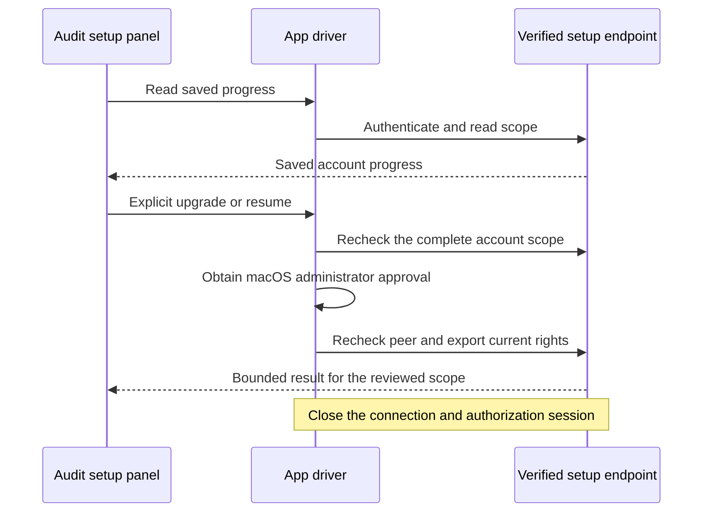

# Audit history setup in the Mac app

The main window shows an "Audit history setup…" button when the setup service is enabled.
The button opens an optional panel.
The existing command setup, pairing and setup file import routes do not change.
The panel reads saved progress before it enables an explicit upgrade or resume action.
A read never requests administrator rights.

## Explicit attempt

`NativeMacAuditUpgradeDriver` is an actor.
It requests approval on its own executor, not on the main actor.
Each read and each attempt opens a new connection.
Before the prompt, the driver reads progress again and checks the full account scope.
It refuses to prompt when the scope changed or when the setup is already current.
The channel verifies the Root peer again before it reads the external authorization form.
The driver closes its authorization session after every attempt.

A waiting result permits another explicit tap.
Nothing is queued, polled or retried automatically.
A cancelled prompt sends no mutation.
After the driver reads the external form, rights may have been sent.
From that point, cancellation or a failure cannot prove that the operation did not run.
The driver reports that outcome as unknown.

## Recovery and presentation

A refused, dropped or expired progress read has an unavailable status.
Another audit upgrade may still be running. The panel does not report that no upgrade ran.
It clears the saved observation and disables changes until an explicit fresh read succeeds.
The preflight path returns this status before requesting or exporting administrator rights.
The synthetic previews include this state in light and dark appearances.

An unknown result clears the saved progress in the panel.
Mutations stay disabled until the user reads saved progress again.
A new read does not repeat the earlier mutation.
Changed progress requires a new review.
Each mutation result must keep the complete reviewed scope.
A malformed or crossed result is reported as unknown.

A read accepts only saved stages:
ready, graph prepared, files changing, files verified, metadata committed and already current.
A read with registration observations is rejected.

The panel keeps three facts separate:

| Fact | What the panel shows |
| --- | --- |
| Cutover saved | "The audit upgrade is saved". It also says that saved setup does not confirm a restart. |
| Registrations confirmed | "Registration checks finished". It says that this does not prove service or phone connectivity. |
| Service health | Never shown. No stage claims healthy services or a connected phone. |

Refresh replaces a registration result with saved metadata.
Saved metadata never counts as a registration result.

Closing the panel cancels its work and suppresses late updates.
It does not claim to undo work that the endpoint already performed.

The panel uses ordinary SwiftUI controls and a scrollable body.
The footer buttons stay outside the scroll view.
Account identifiers stay in an expandable details section.

## Settings

Settings shows a "Setup waits" section with a read wait and a result wait.
See [setup wait settings](audit-upgrade-settings.md).
The driver captures both values for each new connection.

## Synthetic previews

`SetupPreviewSnapshots` accepts an optional `--audit-only` argument.
With it, the tool renders inert panel states, two sizing cases and the settings section.
These previews use synthetic progress and an owned preferences domain.
They open no service connection.

## Verification limits

This change was prepared as source only.
No build, test run, snapshot render or app launch happened for it.
The new test files are `MacAuditUpgradeControlsTests.swift` and `MacAuditUpgradeSettingsTests.swift`.
They cover read-only inspection, scope changes before approval, peer changes during approval,
rights disposal, cancellation before and after a possible send, busy controls, late results after close
and invalid wait settings.
These tests use fake drivers, fake channels and fake rights.

The tests do not qualify native administrator approval, real XPC, Root execution or installed recovery.
No physical phone is involved.
The complete local gate and the Release bundle checks must pass before a push.
