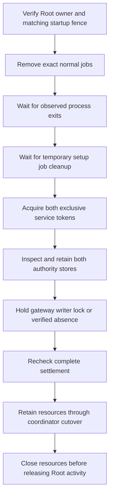

# Native audit cutover drain

`RuntimeAuditUpgradeNativeDrain` composes the runtime resources needed by the durable cutover coordinator.
`openWithNativeDrain` connects that owner to coordinator progress and cleanup.
Restart recovery is a separate operation after resource release.
It is not part of this change.

## Acquisition and retained resources

The native factory requires real and effective Root identity, the retained graph and an exclusive Root activity token.
The caller supplies its authenticated owner check without machine-store calls.
The drain checks the startup fence before acquisition and again before reporting readiness.
Committed cleanup can resume with the fence already absent.

Normal jobs come from the graph's source plans, or its target plans after the metadata commit.
The selection always includes authority, transport and gateway labels, even when historical registration flags are false.
This catches an observed registration after a lost setup reply.
It does not change the retained flags or register a job.

Job removal retains original process witnesses across polls.
A missing registration cannot release an observed process that has not exited.
The temporary gateway setup job must finish before cleanup can remove its registration.
Normal job removal and `RuntimeJobRegistration` require the exact supported launchctl absence diagnostic.
The temporary setup job adapter keeps its existing absence check.
That check requires exit status 113, empty output and the service-not-found message for the job label.

| Resource | What the drain retains |
|---|---|
| Root activity | The caller's exclusive token. The drain never closes it. The coordinator releases it only when it owns it. |
| Transport and gateway activity | Each role's exclusive token and captured lock identity. |
| Authority journal and continuity | Both writer leases and read-only SQLite inspection. |
| Gateway journal | Existing directory, writer and database descriptors, with an exclusive writer lock. |
| Absent gateway journal | The protected parent and repeated absence checks. |

Busy acquisition returns waiting status and keeps resources already acquired.
A retry keeps its existing stop sessions, process witnesses and tokens.
Coordinator cleanup closes this pending drain before releasing Root activity, even before readiness.
If the coordinator cannot open, `openWithNativeDrain` closes the drain and leaves the Root activity token with the caller.

The authority graph requires completed initialization through its configuration bundle.
This drain therefore does not initialize a blank authority journal.
A partial gateway setup retains its existing files without initializing its database.

## Read-only authority storage

`JournalDatabase` and `ContinuityStore` accept a `readOnlyForCutover` mode.
In this mode each store first checks the SQLite header and refuses any `-journal`, `-wal` or `-shm` file.
Then it opens SQLite read-only with `query_only` enabled.
It never changes the journal mode, initializes, migrates or recovers a store.
Every write transaction fails before its body runs.

## Validation and failure

Lifetime validation checks owner, process, lock and file identities without decoding journal contents.
Complete validation also checks local account ownership, removed jobs, temporary-job absence and the paired authority checkpoint.
Neither validation path issues a stop request, initializes a database or repairs stored state.
Machine metadata callbacks can use these checks without reentering the machine store.

The gateway lease opens its descriptors read-only and never opens SQLite.
It preserves database bytes and sidecars, including during incomplete setup.
It rejects substituted identities and unsafe metadata without repairing or deleting them.
Validation failure retires the owner while retaining its locks until cleanup.

After acquisition, retained locks exclude admission while the coordinator removes its fence.
The fence is an interruption marker; it cannot recreate any of these live resources.
Restart eligibility and service health remain separate results.

## Evidence and remaining gates

Owned tests exercise kernel lock exclusion, paired SQLite leases, retries, pending cleanup and complete coordinator progress.
They verify preservation of gateway files and sidecars, absence checks, substituted identities and read-only boundary checks.
Ordinary-identity tests verify native factory refusal before callbacks, filesystem access or launchctl execution.

No positive native entry or installed service operation has run.
No restart operation or authenticated maintenance endpoint uses this drain yet.
Sparkle integration remains unfinished.
Actual launchd removal, legacy process settlement, restart recovery and supported macOS behavior still need platform qualification.
No installed service, production secret or physical device is used by these tests.
