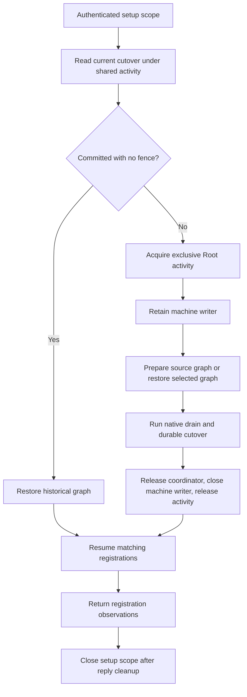

# Audit upgrade operation ownership

`RuntimeAuditUpgradeOperation` owns the authenticated setup scope across graph preparation, cutover and registration recovery.
It composes the existing native adapters.
It keeps cleanup separate from privileged progress.
A later maintenance endpoint and app channel will call this operation. They are not part of this change.

## Outcomes

The operation reports three separate facts. It never merges them.

| Progress | Meaning | What it does not mean |
| --- | --- | --- |
| `readyToRestart` | The cutover completed. Target files and metadata are durable and verified. The startup fence is removed. | Services are not registered yet. |
| `registrationObserved` | The restart owner confirmed the launchd registration of each selected role. | Health is not verified. A matching registration is not a healthy service. |
| `alreadyCurrent` | The runtime already uses the target audit delivery version. No cutover ran. | Nothing about service health. |

The startup fence is removed before services start, because a fence blocks service startup.
No progress value and no result reports a healthy service. This change adds no health policy.

## Preparation and recovery

The native factory requires the Root identity, the authenticated setup scope and the current signed release.
It creates no administrator prompt.
It accepts no caller-supplied path or graph bytes.

Source preparation keeps retained material and credentials. It changes only the audit binding.
It first retains the published source values, so a missing activation plan is rebuilt from protected configuration.
It creates missing role activity locks through the existing protected provisioning code.
It then stages a private candidate.
Finally it captures, retains and restores the private graph before the coordinator starts the cutover.

A selected graph with an existing fence is restored from its committed bytes.
A started cutover never captures a mixture of source and target files as a new source.
An unstarted selection without a fence can capture the current source again. It then replaces its exact old selection.

A committed cutover with no fence goes directly to registration recovery.
This path needs no exclusive activity token and no coordinator.
So recovery works while target services run and gateway settings have advanced.
It never stops those services again only to repair a lost registration reply.
This path restores the private graph copy while it holds shared activity and a short machine borrow.

## Resource lifetime

When activity or the machine writer is busy, the operation returns a waiting progress value. It keeps the resources it already owns.
Before it acquires exclusive activity, the operation closes its shared preflight token and its machine borrow.
A busy exclusive activity attempt publishes no startup fence and keeps no machine writer.

The coordinator borrows the exclusive activity token. The operation owns it.
The coordinator keeps the native drain and its live resources through the file and metadata changes.
Before registration starts, the operation releases resources in this order:

1. The coordinator releases the native drain and pending drain resources.
2. The operation closes the machine writer.
3. The operation releases the exclusive activity token.

The setup scope stays reserved until the caller finishes encoding and sending its reply and closes the operation.

A progress failure retires the operation. It keeps its resources until explicit cleanup.
Starting cleanup also retires progress, even if cleanup later needs a retry.
Cleanup closes the coordinator and pending drain first, then the machine writer and activity token, then the setup scope.
A failed close keeps the remaining resources and the setup admission for another cleanup attempt.
Cleanup can run after administrator rights expire.

If the operation is released without cleanup, `deinit` closes every resource without stopping at a failure.
This last-resort path can release the setup scope while a failed coordinator close leaves the drain in an unknown state.
Callers must call `close()` and retry it until it succeeds.

## Evidence and remaining work

Ordinary-owner integration fixtures use temporary files, SQLite stores, real activity locks and simulated quiescence and launchd adapters.
They cover complete progress, busy activity, interrupted file phases, lost restart replies and settings progress after commit.
They check that the activity token stays held until the machine writer closes.
They also check cleanup failure retention and that the native factory refuses an ordinary identity before it uses the scope.

Positive native preparation, launchd operations and installed recovery remain unqualified.
The managed worker, invocation, maintenance endpoint, XPC request and app progress panel are separate later work.
No installed service, production credential or physical device is used by these tests.
