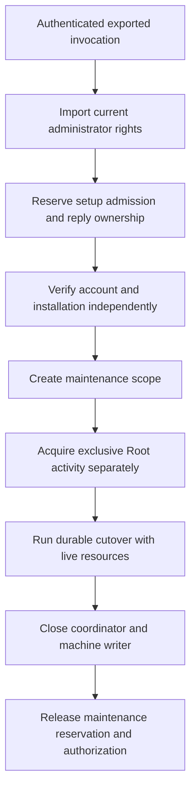

# Audit recovery authorization and ownership

Audit recovery needs administrator consent and an independent account check while the startup fence blocks normal setup.
`SetupAuditUpgradeAuthorization` and `SetupAuditUpgradeScope` provide those prerequisites.
`SetupAccountOwner.acquireAuditUpgradeScope` creates the scope.
The maintenance endpoint, the client handshake, the progress codec and the operation owner are not part of this change.
Later changes add them and use this scope.

This change implements the steps from "Import current administrator rights" to "Create maintenance scope", and the final release.
The other steps belong to the operation owner.

## Administrator rights

The native grant factory must run synchronously on the authenticated exported XPC invocation, before task dispatch.
Its connection must already enforce the protected signing requirement and complete the expected handshake.
The factory binds the kernel caller UID to the imported authorization reference.
A decoded request, progress record or saved phase cannot create this object.

The helper imports only existing administrator rights.
It requests no interaction, extension, partial rights or preauthorization.
It rechecks the administrator rule and rights whenever the grant is used.
It keeps no password and does not retain or write the external authorization form.
It releases its imported reference without destroying the app's authorization session.

`SetupAdministratorNative.importCurrentRights` performs the import.
The existing `validate(externalForm:)` check now calls it and releases the reference at once.

## Reservation and account binding

The setup owner reserves its asynchronous operation and reply admission together.
It selects the account through the grant's caller UID.
It verifies prepared storage, completed initialization, installation identity, release digest, code policy and local directory identity.
These checks do not call the normal startup-fence accessor.
Normal enrollment and setup keep their existing fence checks.

A successful scope takes ownership of the authorization grant and both reservations.
Failed admission leaves the grant with its caller and releases partial reservations.
A second scope cannot take the first scope's admission.
Other setup operations and shutdown wait for the reservation to end.

The reservation holds no shared Root activity token.
Recovery can therefore acquire an exclusive Root token without waiting on its own setup admission.
The operation owner still needs the separate runtime drain, machine writer and coordinator.
The reservation itself grants none of those resources.

## Lifetime and cleanup

`validateLifetime` checks rights, process identity, reservation ownership, the protected host and the local account.
It calls no machine-store method.
It can therefore run inside metadata verification callbacks of the machine store.
`withMachine` opens a separate machine borrow and rechecks the stable account, initialization and installation bindings.
It closes the borrow before it returns.
It refuses nested borrows, and it refuses `close` during a current operation.

Rights expiry, host or account changes, and owner shutdown stop further use.
Cleanup does not require administrator rights to remain valid.
The operation owner must close its coordinator, pending drain and machine writer before it closes the maintenance scope.
This keeps the setup reservation and host placement until the live runtime resources end.

The scope does not check this order itself.
If the last reference to an open scope is dropped, its deinitializer releases the grant and both reservations.
The invocation owner must therefore keep the scope, or the operation that holds it, until the operation, its reply and its cleanup have ended.

## Evidence and remaining work

Owned tests use real disposable machine stores and Root-activity lock fixtures with simulated administrator grants.
They check fenced recovery, unchanged normal fence checks, exclusive update activity, transaction-safe lifetime checks and cleanup.
They also cover expired rights, a changed host or account, failed or duplicate admission, reentry and shutdown.
Existing administrator tests use uncredentialed references and request no prompt or elevation.
The native grant test only checks refusal from an ordinary identity before invocation or rights access.

Native credential import, accepted XPC routing and installed recovery are not qualified.
These tests use no installed service, production credential or physical device.
