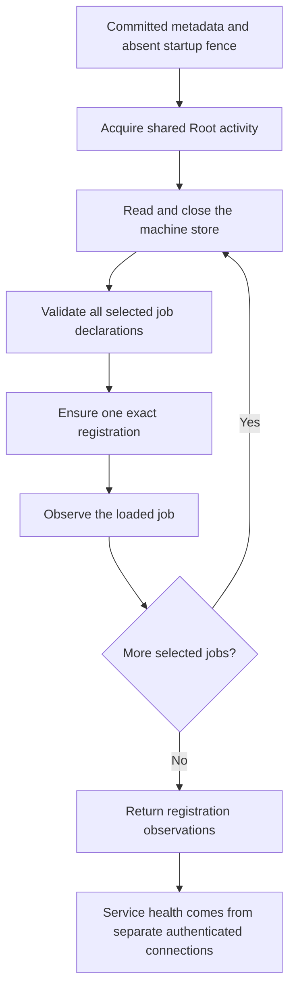

# Audit cutover restart recovery

`RuntimeAuditUpgradeRestart` resumes job registration after the audit cutover releases its resources.
It preserves the original registration choices and reports registration observations separately from service health.

## Selection and recovery

Only jobs enabled before the cutover are selected.
Foreground registration selects authority and transport.
Gateway registration additionally requires the retained published gateway activation.
An unregistered or partially prepared service is not enabled by restart recovery.
The operation never changes registration flags, creates job files or initializes a service.

Before registration, the operation requires the exact committed cutover, retained graph, target runtime binding and current signed release.
It checks account preparation, initialization, selected activation plans and original registration choices.
The current inventory must retain the same installation and release and contain the selected declarations.
The native owner also verifies the local account identity.

All selected plist files are validated before the first job can start.
Each job is checked again around registration and its final observation.
A conflicting job is refused without replacement or removal.
A failed bootstrap reply is reconciled against the loaded declaration.
Retry preserves existing matching registrations rather than issuing another bootstrap.

## Machine ownership and settings recovery

The cutover coordinator and its machine writer must close before this operation starts.
The native entry point opens its own Root activity barrier and acquires a fresh shared token.
It releases that token when it returns.
A caller that still holds an exclusive Root activity token, owned or borrowed, must release it first.
Otherwise the shared token request fails as busy.
A fresh shared Root activity token excludes another update while allowing service admission.
Every machine borrow closes before launchctl or service observation runs.
A persisted cutover phase cannot substitute for those live ownership checks.

Normal startup can advance pending settings after the first job starts.
Restart therefore validates stable runtime bindings and selected job files without freezing the old settings transition.
It does not reuse the cutover's full target-file snapshot after services resume.
Each service retains its own configuration, credential and protocol admission checks.

Owner loss, a new startup fence, changed stable metadata or a substituted plist stops further registration.
Already registered jobs remain intact for the next authenticated recovery attempt.
No rollback stops a service that has already resumed.

## Evidence and remaining gates

Owned tests exercise committed file and metadata fixtures followed by fresh machine connections and simulated launchd observations.
They cover the original flags, partial setup, lost replies, interruption, settings progress, conflicts, new fences and owner loss.
The registration callbacks also acquire an independent machine lease to prove the previous borrow has closed.
Native refusal tests run from ordinary identity before callbacks or job commands.

These tests do not qualify actual launchd registration, process health or a real interrupted update.
Native job observation uses `RuntimeJobRegistration.inspect`, which comes with the native drain slice.
In this slice no production caller invokes restart recovery.
The upgrade operation and the authenticated maintenance endpoint that invoke it come in later slices.
Sparkle integration remains unfinished.
Installed-service and physical-device checks remain deferred to the user's interactive session.
