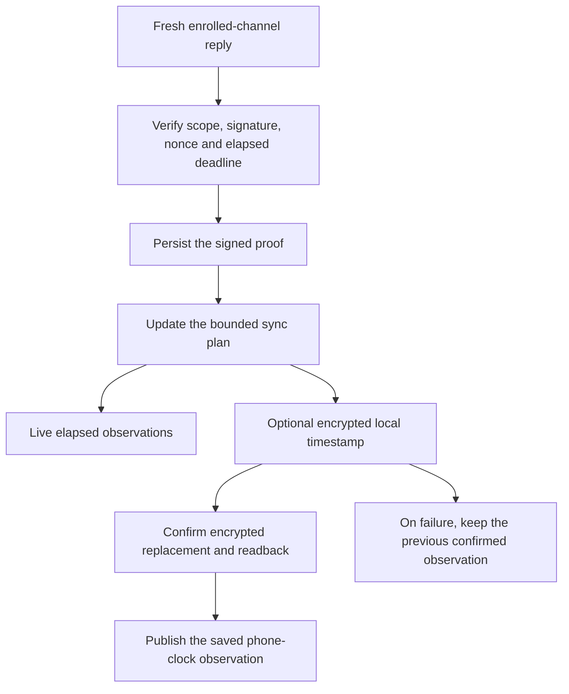

# Local phone sync observations, version 1

The signed-proof cache remains unchanged. This optional sidecar records when this phone accepted a verified response and completed a bounded round.
These times use the phone wall clock. They never establish current trust, Mac presence, current journal selection or action authority.
Clock changes can move them backwards. Ordering follows acceptance, not the greatest timestamp.

Offline import verifies retained evidence but never records a new observation or restores a live round.
Invalid, expired or unpersisted replies cannot advance a saved timestamp.
A conflicting signed reply may record a last-response observation but never a successful completion.
Metadata failure preserves all signed evidence and does not fail a successfully completed round.
After an ambiguous metadata write, reopening may recover a committed observation only if its proof reference verifies.

## Separate local format

The sidecar uses the cache's existing AES-256 key with fresh GCM nonces.
It has the distinct envelope magic `RMZAS001` and associated-data domain `dev.remozio.audit-local-sync`.
The associated data binds the complete Mac/account/Root identity and schema1. The proof envelope/domain remain unchanged.
Swapping envelope magic cannot cross those cryptographic purposes.
The complete sidecar has a 1060-byte ceiling, including its 36-byte encryption overhead.
Its canonical CBOR plaintext permits1024bytes,depth3 and24items.

| Field | Value |
| --- | --- |
| 0 | Local metadata schema1 |
| 1 | Last verified response: `[phoneUnixMilliseconds, proofID]` |
| 2 | Last completed round: the same tuple or `null` |

A timestamp is positive and no later than year9999. The proof ID has32bytes.
It is SHA-256 over the fixed local-proof domain, kind byte, exact canonical body and retained64-byte signature.
Every referenced proof must exist in the verified cache for that identity. A completion reference must be free of retained conflicts.
Unknown fields, unsupported schemas, malformed values, missing references, oversized or damaged ciphertext produce unknown local time.
Reading never repairs or rewrites the proof archive or records the import as a new sync.
A later fresh verified response may replace unavailable display metadata.

The Android sidecar path is `audit/v2-<binding identity>.local-sync` in no-backup storage.
This name is reserved for local metadata schema1; a later format must use another versioned name.
Existing app versions ignore this sidecar and can still read the unchanged proof archive.
The existing v2 cache file lock protects both files until the cache closes. A sidecar never owns or releases that parent lock.
The current cache key is required. Reading retained history creates no key. Legacy migration does not invent old sync times.

## Qualification

This prepared source has not compiled or run tests.
The format, migration, identity, failure and display controls require fresh qualification.
The native interoperability tests require rebuilt peers with verified source inputs.
Earlier private component counts and captures do not transfer automatically.
Android Keystore, AtomicFile and installed delivery remain unqualified.
Saved dates never establish current Mac presence or action authority.
